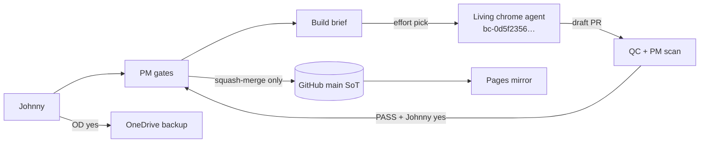

# Site infra — workbook #95

**Owner:** IFRS Build · **Updated:** 2026-10-21 Asia/Shanghai  
**Update:** same PR as any infra change.

## Source of truth

| Layer | Role | Where |
|---|---|---|
| **GitHub `main`** | **SoT** for site code | `https://github.com/johnnypangkh/ifrs-study` |
| **GitHub Pages** | Mirror of `main` (can lag) | `https://johnnypangkh.github.io/ifrs-study/` |
| **OneDrive** | Backup after Johnny yes — never edit & copy back | `00. IFRS Web/ifrs-website-refs/` (Johnny confirmed) · workbook `00. IFRS Web/IFRS-STATUS.xlsx` |
| Box `/workspace/style-base/` | Scratch only | Not live |
| Draft PR | WIP | Not live until PM squash-merge |

## Pipeline

**Build never merges.** After W2b → FAIL-only until W4 / new GO.

## When stuck — look here

| Stuck on | Look |
|---|---|
| What is live vs draft? | SoT table above · runbook § Pages check |
| Who merges? | PM only after Johnny yes |
| Which Cursor agent? | `bc-0d5f2356-769c-5035-99f6-b057b5ad7190` · [agent](https://cursor.com/agents/bc-0d5f2356-769c-5035-99f6-b057b5ad7190) |
| OD path? | `00. IFRS Web/ifrs-website-refs/` |
| Repo docs path? | `docs/site-infra/` |
| Full ops steps | `SITE-INFRA-RUNBOOK.md` |
| Map cite count lint fails? | runbook § CI gates with pinned counts |
| Map lint says shared class collision? | runbook § CI gates with pinned counts (rename the plate class; never edit the shared rule) |
