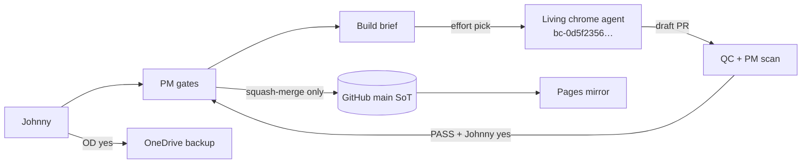

# Site infra — workbook #95

**Owner:** IFRS Build · **Updated:** 2026-10-30 Asia/Hong_Kong · #127 IAS 2 EX 25.46 densify → source sync (ch02/ch05) + build-last-update stamp cascade (lesson #111; V7 N/A withdrawn; Johnny t182s1103). · 2026-10-28 Asia/Hong_Kong · #126 FAIL-only#2 source sync: ias-2/source/ch*.md catch up to shipped 2026 teaching HTML so build-chapter --check/--all no longer wipe KEEP HTML (lesson #111). · #126 IAS 2 PwC MOA 2026 cite refresh → CONTENT_ALLOW (8 teaching HTML) + build-last-update stamp cascade (lesson #111; V7 N/A withdrawn). · #125 IAS 16 Master Map attrs-only brick-compose (12→79; `fold_b2_125`; stamp cascade) · #124 Master Map mf-lego-entry REMOVE (fold_mf_lego_entry KEEP; stamp cascade lesson #111) · #123 CF Status Yes leaf dedicated fold + build-last-update stamp cascade (lesson #111) · #100 live `site/master-formatting/` · #109 timeline module · #120 remaining extract (pack placement only) · #121 shared brick module (`lego-bricks.css`, after map-box / timeline-1, not map-box) · #122 Concept Map L0 is solid `var(--bg)` (graph-paper and `--map-field-*` retired; lint FAILs a residual field)
**Update:** same PR as any infra change.

## Source of truth

| Layer | Role | Where |
|---|---|---|
| **GitHub `main`** | **SoT** for site code | `https://github.com/johnnypangkh/ifrs-study` |
| **GitHub Pages** | Mirror of `main` (can lag) | `https://johnnypangkh.github.io/ifrs-study/` |
| **OneDrive** | Backup after Johnny yes — never edit & copy back | `00. IFRS Web/ifrs-website-refs/` (Johnny confirmed) · workbook `00. IFRS Web/IFRS-STATUS.xlsx` |
| Box `/workspace/style-base/` | Scratch only | Not live |
| Draft PR | WIP | Not live until PM squash-merge |

## Pipeline

**Build never merges.** After W2b → FAIL-only until W4 / new GO.

## When stuck — look here

| Stuck on | Look |
|---|---|
| What is live vs draft? | SoT table above · runbook § Pages check |
| Who merges? | PM only after Johnny yes |
| Which Cursor agent? | `bc-0d5f2356-769c-5035-99f6-b057b5ad7190` · [agent](https://cursor.com/agents/bc-0d5f2356-769c-5035-99f6-b057b5ad7190) |
| OD path? | `00. IFRS Web/ifrs-website-refs/` |
| Repo docs path? | `docs/site-infra/` |
| Full ops steps | `SITE-INFRA-RUNBOOK.md` |
| Map cite count lint fails? | runbook § CI gates with pinned counts |
| Map lint says shared class collision? | runbook § CI gates with pinned counts (rename the plate class; never edit the shared rule) |
| Where is the live Master formatting page? | `site/master-formatting/` (Johnny V6 path A, #100). Settings (`site/settings/`) is the token table, not MF. LEGO sheet is section `#lego-sheet` on the MF page. |
| Where is shared timeline chrome? | `_shared/modules/visuals/timeline-1.css`, imported by `_shared/visuals.css` (#109, remaining extract #120). Not `map-box.css`. #120 is done: B1/B2/key/rd-left/cite-run and the Dep/Impair layout near-dup live here. IAS 16 `ias16.css` keeps plate placement only. |
| Where is shared brick CSS? | `_shared/modules/visuals/lego-bricks.css`, imported by `_shared/visuals.css` after `map-box.css` / `timeline-1.css` (#121, Gap G2 / Option 4). Not `map-box.css`. Unknown `data-brick` B## FAILs in `tools/map-lint.py` (B01–B21). Wave B attrs KEEP. No paint Δ. |
| Where is Concept Map L0 background? | `_shared/modules/visuals/map-box.css` `.m-l0` is solid `var(--bg)` (#122). Graph-paper field and `--map-field-line` / `--map-field-pitch` / `--map-field-stroke` are retired (LOCK-#89 / kit 2 STRUCK). `tools/map-lint.py` FAILs a residual field. Not a plate-layout change. |
| CF Status Yes leaf stamp still fails? | #123 on `cf-2018/draft-v1-linked/index.html`: three outcome leaves (`m-l4`→`m-l2` + `data-brick="B03"`) need a dedicated `check-stamp-only` fold (shape #117/#118/#119) and `tools/build-last-update.py` regen of `_shared/last-update.js` + consumer `last-update.js?v=`. Stamp alone cannot clear the leaf class+attrs. Not a `CONTENT_ALLOW`. Not a `stamp-assets.py` CSS restamp. |
| Master Map LEGO chrome link gone? | #124 removed `a.mf-lego-entry` from `ias-16/draft-v1-linked/visuals/master-concept-map.html`. Do not re-add that Concept Map chrome link. Findability = homepage Ready #116 + Settings quiet entry + MF `#lego-sheet`. Stamp fold `fold_mf_lego_entry` is still present (strip-if-present; no-op once the tip lacks the needle). Pack CSS `.page > a.mf-lego-entry` is retired from `ias16.css`. Settings `_shared/settings.css` KEEP. site-rules §4 amend is PM after merge. |
| Master Map brick stamp still fails? | #125 on `ias-16/draft-v1-linked/visuals/master-concept-map.html` plus the chapter map-sections it includes (not ch05). Attrs-only B09/B12/B14/B20. `fold_b2_125` is path-gated and count-gated (NEW→OLD). Not a `CONTENT_ALLOW`. `bash tools/build-all.sh` refreshes the stamp cascade. Do not put B19, `pack-flow-in`, or `data-brick="B20"` on a phase `a.rail-link`. |
| IAS 2 teaching cite stamp still fails? | IAS 2 teaching HTML cite refresh (`ias-2/draft-v1-linked/` ch01–ch06 + references + index) needs those eight paths on `CONTENT_ALLOW` and `tools/build-last-update.py` regen of `_shared/last-update.js` + consumer `last-update.js?v=` (lesson #111; not a needle fold; not Map). |
| IAS 2 HTML ahead of source? | When teaching HTML ships ahead of `ias-2/source/*.md`, sync source to HTML (not HTML→2020) before `build-all` / `build-chapter --all`; then stamp cascade. Eight-path `CONTENT_ALLOW` still required. |
| IAS 2 EX 25.46 densify ahead of source? | Densify teaching HTML under `ias-2/draft-v1-linked/ch02.html` + `ch05.html` needs `ias-2/source/ch02.md` + `ch05.md` synced (reverse-extract preferred) **before** `build-all` / `build-chapter`, then `tools/build-last-update.py` regen of `_shared/last-update.js` + consumer `?v=`. Tip `#126` CONTENT_ALLOW already covers those HTML paths — do not invent a new allow. `changes/189.yml` records densify rewrites for check-incremental. |

## Live pages under `site/`

| Path | What it is | Stamp |
|---|---|---|
| `site/settings/` | Settings — Master styles token table. Not Master formatting. | Pack key `site` |
| `site/master-formatting/` | Live Master formatting page (#100). LEGO kit sheet is `#lego-sheet` on this same page. | Pack key `site`. `stamp-assets.py` `settings_pages()`, `build-last-update.py` path list + site fingerprint, `chrome-packs.js` `CHROME_PACK_PATHS`, `check-stamp-only.py` `?v=`-only (same shape as Settings). Page CSS stays on the page. `kit.css` is not in `_shared`. |
